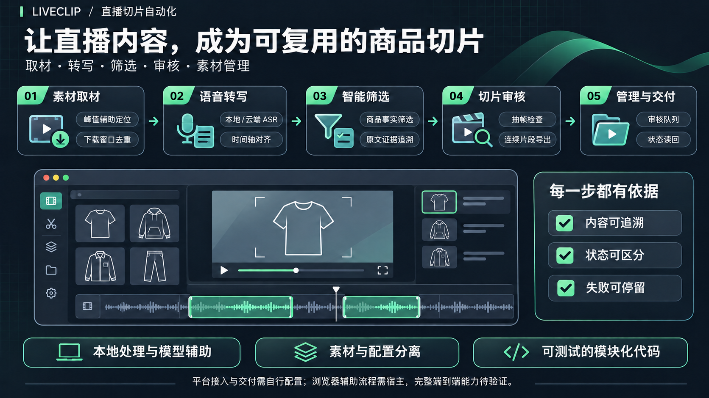

# LIVECLIP｜直播切片助手

**从长时间直播中找到值得复用的商品讲解，整理成可审核、可交接的短视频素材。**

适合直播运营、内容剪辑和投流团队协作使用：运营提供直播素材与选材依据，工具辅助转写、筛选和导出，团队集中审核候选片段，再决定如何使用。

> 图中界面为功能示意。当前提供的是需要部署配置的工具项目；实际使用方式与已接通的平台能力以部署情况为准。

## 它能帮业务团队做什么？

| 日常遇到的问题 | 可以提供的帮助 | 业务人员拿到什么 |
| --- | --- | --- |
| 直播太长，逐段回看费精力 | 利用已核实的销售高点辅助定位取材时段，记录下载窗口，减少重复取材 | 待处理素材清单及对应时段 |
| 听完才知道讲了什么，不便快速找卖点 | 将语音转成文字，并辅助对齐视频时间 | 可回查原片的讲解文字与时间位置 |
| 催单、优惠提醒、闲聊和商品讲解混在一起 | 优先筛选包含具体商品事实、语义相对完整的连续讲解 | 候选片段、入选理由与原文依据 |
| 文字合适，画面却可能空镜或商品不一致 | 对候选片段抽帧检查画面，并辅助判断讲解是否完整 | 审核结果及需要人工复核的片段 |
| 片段整理分散，交接时容易混淆 | 导出通过流程审核的连续切片，记录素材状态，支持整理交付包 | 视频文件、审核记录和交接材料 |
| 素材是否上传、交付成功说不清 | 配置平台接入后，记录任务状态并读回核对，异常保留待处理 | 可追踪的素材处理记录 |

## 从一场直播到一批候选素材

**提供素材 → 转写讲解 → 筛选候选 → 人工复核 → 整理交付**

1. **运营确定取材方向。** 提供直播原片，或结合已核实的高点选择取材窗口。高点帮助缩小回看范围，不代表该句话带来了成交。
2. **工具完成初筛。** 转写讲解，筛出商品信息较明确的连续片段，附上对应文字和筛选理由。
3. **团队集中审核。** 回看候选片段，确认商品、卖点、价格条件、画面和剪点；修正或淘汰不合适的内容。
4. **整理可交接素材。** 导出符合要求的片段，保留审核记录。后续可由团队用于内容制作、素材备选或投放前准备。

## 本次新增的业务支持

- **讲解与画面结合复核：** 新增豆包音频转写及音画审核流程，辅助检查候选片段是否讲完整、画面是否匹配；转写和剪点仍需人工确认。
- **原片与精选切片分开交接：** 支持分别整理原片包和精选切片包，方便复查来源与继续剪辑；打包前核对素材、审核及上传记录。
- **上传后继续核对：** 新增标签与投放中计划的状态核验流程，保留未完成和异常记录，便于运营知道哪些素材仍需处理。涉及平台修改的步骤需另行配置并明确授权。
- **交付完成再判断能否清理：** 提供双包交付核验条件，两个包都确认送达后才满足清理前提；打包完成不等于已发送。

以上为新增模块支持的流程，不代表已完成实际平台端到端验收。

## 不同岗位，怎么用？

| 岗位 | 重点用途 |
| --- | --- |
| 直播运营 | 整理值得复用的讲解时段，把选材依据和素材一起交给内容团队 |
| 剪辑与内容人员 | 从候选片段和文字依据开始复核，减少从整场直播里反复寻找内容的工作 |
| 投流人员 | 获得经过初步筛选、可追溯来源的素材备选，结合商品资料和投放要求再次审核 |
| 项目负责人 | 查看素材处于待审核、已处理、待交付还是异常状态，明确下一步由谁跟进 |

## 可以期待的帮助

- **缩小人工回看的范围：** 从整场浏览转向重点时段和候选片段复核。
- **让选材依据更清楚：** 片段与原文、时段和审核理由对应，便于团队沟通。
- **减少重复整理：** 记录已下载窗口和处理状态，帮助避免重复取材、重复提交。
- **让交接更完整：** 视频与审核记录一起整理，方便后续复查与继续制作。

这些是工具的工作目标与支持方式。目前没有经过验证的节省工时比例、素材产量或投放收益承诺；具体效果需要用团队的真实素材试用评估。

## 使用前需要知道

**目前已有：** 本地素材处理、转写与候选筛选、抽帧审核、切片导出，以及素材队列和交付记录相关模块。

**需要接入配置：** 浏览器取材辅助、模型服务、平台素材上传和消息交付。完整的无人值守流程仍需联调与验证。

**仍需人工把关：** 商品事实、宣传口径、价格条件、剪辑完整性和最终使用决定。抽帧审核不能覆盖每一帧；转写与时间对齐也可能有误。没有合格片段时允许无产出，错误或缺失结果会保留为待处理状态。

## 如何开始

先选择一段有代表性的直播素材，由技术人员完成部署，再由运营与剪辑共同试用，重点评估：候选是否值得看、文字是否准确、剪点是否自然，以及交接材料是否够用。

[部署与开发说明](docs/TECHNICAL_GUIDE.md) · [脱敏与验证说明](docs/SANITIZATION.md)
